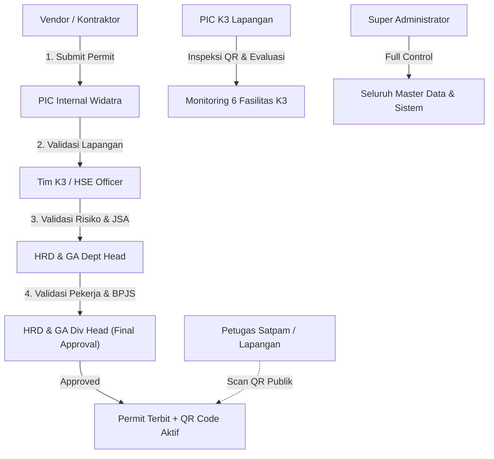
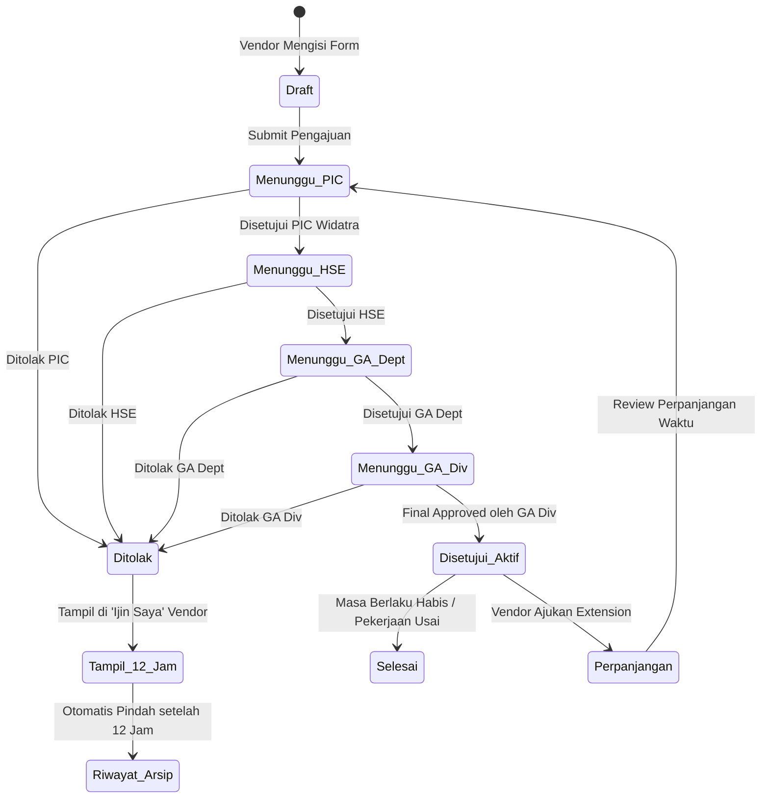
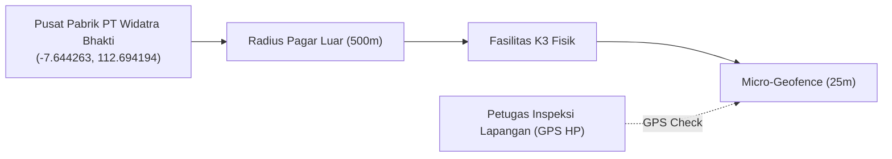
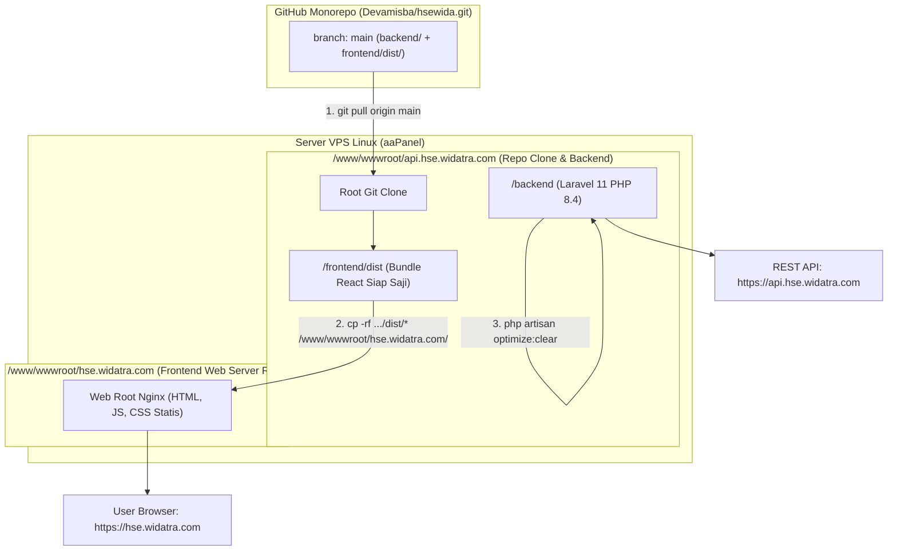

# 📘 PRODUCT REQUIREMENT DOCUMENT (PRD)
## SISTEM DIGITAL WORK PERMIT & SAFETY MONITORING (SIM-K3)
### PT WIDATRA BHAKTI

---

| Dokumen Info | Deskripsi |
|---|---|
| **Nama Proyek** | HSE Digital Work Permit & Safety Facility Monitoring |
| **Organisasi / Perusahaan** | PT Widatra Bhakti (Otsuka Group) |
| **Versi Dokumen** | 2.0 (Production Release) |
| **Target Lingkungan** | Local Dev (`localhost`), Staging, & Production aaPanel VPS |
| **Repositori GitHub** | `https://github.com/Devamisba/hsewida.git` (Branch: `main`) |
| **URL Production** | Frontend: `https://hse.widatra.com` \| Backend API: `https://api.hse.widatra.com` |
| **Penyusun** | Tim Pengembangan Sistem HSE Widatra Bhakti |

---

## 1. EXECUTIVE SUMMARY & LATAR BELAKANG

### 1.1 Latar Belakang
PT Widatra Bhakti sebagai industri farmasi manufaktur memiliki komitmen tinggi terhadap kepatuhan **Keselamatan dan Kesehatan Kerja serta Lindungan Lingkungan (K3LL)**. Sebelumnya, proses perizinan kerja pihak ketiga (vendor/kontraktor) dan pemantauan fasilitas K3 (seperti APAR, Hydrant, Kotak P3K, Pintu Darurat, dsb.) dilakukan secara manual berbasis kertas. Hal ini menimbulkan tantangan:
- Risiko kelalaian pemantauan kadaluarsa alat consumable (isi tabung APAR & obat P3K).
- Proses persetujuan *Job Safety Analysis (JSA)* yang lambat dan birokratis.
- Lemahnya pelacakan bukti riil kehadiran fisik inspektur saat pengecekan alat di lapangan.
- Ketiadaan verifikasi real-time izin kerja di pos keamanan satpam tanpa login.

### 1.2 Tujuan Produk
1. **Digitalisasi Penuh Izin Kerja (Work Permit)** dengan alur persetujuan bertingkat 4 level (*Sequential Approval*) yang aman, transparan, dan dapat dipantau real-time.
2. **Sentralisasi Pemantauan 6 Fasilitas K3** dengan *5-Tier Expiry Horizon*, indikator real-time inspeksi bulanan, dan sistem antrean refill otomatis.
3. **Validasi Fisik & Anti-Fraud** melalui pemindaian QR Code di unit dan validasi spasial GIS Geofencing (radius 500m pabrik & 25m mikro-geofence unit).
4. **Verifikasi Publik Cepat Tanpa Akun** bagi petugas keamanan satpam di gerbang utama untuk memvalidasi izin kerja kontraktor aktif.

---

## 2. PENGGUNA SISTEM & MATRIKS OTORITAS (RBAC)

Sistem membagi pengguna ke dalam 7 peran (*roles*) dengan hak akses terisolasi:



### Matriks Kewenangan Lengkap:
| No | Role | Akun Default | Otoritas & Tanggung Jawab Utama |
|---|---|---|---|
| 1 | **Super Admin** | `admin@hse.com` / `SA12345` | Akses penuh master data, manajemen pengguna, konfigurasi sistem, dan audit log. |
| 2 | **Vendor / Kontraktor** | `vendor@hse.com` / `VN10001` | Mengajukan izin kerja baru, upload dokumen pekerja, JSA, APD, memantau riwayat, dan pengajuan perpanjangan (*extension*). |
| 3 | **PIC Internal Widatra** | `pic@hse.com` / `PC10002` | **Approval Level 1**: Verifikasi kesiapan teknis lapangan dan area kerja kontraktor. |
| 4 | **Tim K3 / HSE** | `hse@hse.com` / `HS10003` | **Approval Level 2**: Analisis bahaya JSA, validasi APD wajib, kepatuhan K3, dan pengelolaan master fasilitas K3. |
| 5 | **PIC K3 Lapangan** | `pick3@hse.com` / `PK10006` | Melakukan scan QR lapangan, checklist kondisi fisik/tekanan, upload foto bukti ber-watermark, dan pengajuan antrean refill. |
| 6 | **HRD & GA Dept Head** | `ga_dept@hse.com` / `GA10004` | **Approval Level 3**: Verifikasi legalitas perusahaan vendor, data pekerja, kepesertaan BPJS Ketenagakerjaan. |
| 7 | **HRD & GA Div Head** | `ga_div@hse.com` / `GA10005` | **Approval Level 4 (Final)**: Pengesahan akhir penerbitan surat izin kerja resmi ber-QR Code. |
| 8 | **Publik / Satpam (No Login)**| - | Memindai QR Code izin kerja di pos satpam untuk verifikasi status aktif tanpa hak edit data. |

---

## 3. ANALISIS FITUR & ALUR KERJA (WORKFLOW)

### 3.1 Modul Digital Work Permit (Ijin Kerja)



#### Fitur-Fitur Kunci Work Permit:
1. **Formulir Pengajuan 4 Tahap Terpandu**:
   - *Langkah 1*: Informasi Perusahaan, Proyek, Lokasi Pabrik, Waktu Pengerjaan, dan PIC Pengawas.
   - *Langkah 2*: Identifikasi Risiko & Job Safety Analysis (JSA) per langkah kerja.
   - *Langkah 3*: Matriks Kebutuhan Alat Pelindung Diri (APD) Standar & Khusus.
   - *Langkah 4*: Daftar Tenaga Kerja, No KTP, Unggah Sertifikat Keahlian & Bukti BPJS Ketenagakerjaan.
2. **Kebijakan Retensi 12 Jam Izin Kerja Ditolak**:
   - Jika suatu pengajuan ditolak di tahap mana pun, permohonan tersebut tetap ditampilkan pada tab *"Ijin Saya"* akun Vendor selama **maksimal 12 jam sejak ditolak**.
   - Tujuan: Memberikan waktu yang cukup bagi vendor untuk membaca catatan/alasan penolakan dari peninjau, segera melakukan perbaikan, atau membuat permohonan baru.
   - Setelah melewati jendela 12 jam, permohonan otomatis diarsipkan ke halaman *"Riwayat"* secara sistemik.
3. **Mekanisme Perpanjangan Izin (Permit Extension)**:
   - Vendor tidak perlu menginput ulang seluruh data pekerja dan JSA jika pekerjaan membutuhkan tambahan waktu beberapa hari. Cukup mengajukan perpanjangan tanggal yang akan masuk kembali ke antrean peninjauan.
4. **Cetak Surat Izin Kerja Resmi (PDF)**:
   - Dilengkapi identitas korporat PT Widatra Bhakti, nomor izin kerja unik (`WP-YYMM-XXX`), daftar tanda tangan digital bertingkat, dan stempel QR Code.
5. **Verifikasi Publik QR Satpam (`/verify-permit/:token`)**:
   - Setiap permit yang terbit memiliki QR Code unik. Petugas keamanan di gerbang utama cukup memindai QR Code dengan smartphone biasa tanpa perlu login untuk memverifikasi keabsahan izin.

---

### 3.2 Modul Monitoring & Kesiapan Fasilitas K3

Sistem mengelola dan memantau 6 kategori fasilitas K3 di lingkungan pabrik PT Widatra Bhakti:
1. **APAR** (*Alat Pemadam Api Ringan*) — Kategori Consumable (tekanan & tanggal expired).
2. **Hydrant** (*Hydrant Pillar & Box*) — Kategori Kondisi Fisik.
3. **Kotak P3K** (*Obat-obatan Tipe A/B/C*) — Kategori Consumable (expired obat).
4. **Pintu Darurat** (*Emergency Exit Door*) — Kategori Kondisi Fisik.
5. **Cermin Keselamatan** (*Safety Convex Mirror*) — Kategori Kondisi Fisik.
6. **Titik Kumpul** (*Assembly Point Area*) — Kategori Kondisi Fisik.

#### A. 5-Tier Horizon Kadaluarsa (Masa Berlaku Fasilitas Consumable)
| Kategori Horizon | Rentang Hari | Kode Indikator | Aksi Sistem |
|---|---|---|---|
| **Aman** | `> 365 Hari` (> 1 Tahun) | Hijau Emerald | Status prima, tidak perlu tindakan pengisian ulang. |
| **H-1 Tahun** | `181 - 365 Hari` (6-12 Bulan) | Kuning Emas | Mulai dijadwalkan dalam anggaran pemeliharaan K3 tahunan. |
| **H-6 Bulan** | `91 - 180 Hari` (3-6 Bulan) | Oranye | Masuk daftar perhatian monitoring K3 berkala. |
| **H-3 Bulan** | `0 - 90 Hari` (< 3 Bulan) | Oranye Kemerahan | Prioritas pemesanan isi ulang tabung / restock obat. |
| **Expired** | `< 0 Hari` (Lewat Jatuh Tempo) | Merah Menyala (*Blink*) | Masuk otomatis ke antrean darurat isi ulang tabung / ganti isi. |

#### B. Tracker Real-Time Jadwal Inspeksi Bulanan
- Menampilkan metrik kepatuhan inspeksi fisik di bulan berjalan secara realtime (*contoh: 232 sudah dicek, 34 belum dicek dari total 266 unit APAR*).
- Indikator sisa hari sebelum pergantian bulan.
- Filter cepat 1-klik: tombol *"Belum Dicek Bulan Ini"* untuk langsung menampilkan fasilitas yang memerlukan inspeksi fisik petugas.

#### C. Client-Side Pagination 15 Data
- Tampilan tabel APAR dan fasilitas lainnya dipaginasi secara presisi sebanyak **15 data per halaman** (`[<] [1] [2] [3] [>]`).
- Desain tombol navigasi aktif menggunakan warna *solid navy blue* (`#1E3A8A`) dengan sudut membulat.
- Tombol navigasi otomatis disabled di batas awal/akhir dan otomatis mereset ke halaman 1 setiap kali pengguna mengganti filter zona atau kata kunci pencarian.

#### D. Template Excel Import Master Fasilitas K3 (Professional Styling)
- Template dibuat menggunakan library `ExcelJS` dengan standar korporat PT Widatra Bhakti.
- **Fitur Template**:
  - *Freeze Panes*: Baris header tetap terkunci saat menggulir ke bawah.
  - *Corporate Banner*: Judul resmi dan panduan singkat di baris atas.
  - *Excel Data Validation*: Dropdown menu interaktif di kolom Kategori (`apar`, `hydrant`, dll), Tipe (`CONSUMABLE`, `KONDISI`), dan Zona (`UMUM`, `FACTORY 1`, `FACTORY 2 & WORKSHOP`, `WARE HOUSE`) untuk mencegah kesalahan ketik pengguna.
  - *Smart Header Parser*: Sistem mendeteksi baris header secara dinamis (rentang baris 0 s/d 9) sehingga fleksibel menerima format template baru maupun file kustom lama.

#### E. Antrean Refill APAR & Cetak Stiker QR
- Petugas dapat memasukkan tabung yang habis atau expired ke dalam *Antrean Refill*.
- Fitur cetak stiker QR fisik berukuran standar kartu untuk ditempel langsung di tabung atau kotak fasilitas.

---

### 3.3 Modul GIS Geofencing & Peta Interaktif Spasial



1. **Polygon Geofence Pabrik (500m Radius)**:
   - Koordinat acuan: Latitude `-7.644263`, Longitude `112.694194`.
   - Menggunakan peta interaktif berbasis Leaflet dengan marker visual untuk setiap kategori fasilitas.
2. **Micro-Geofence Unit (25m Radius)**:
   - Memastikan inspektur benar-benar berada di depan fisik unit saat melakukan scan QR melalui koordinat GPS smartphone. Mencegah manipulasi checklist dari jarak jauh.

---

### 3.4 Modul Dual-Tier Mobile QR APAR Scan (`/scan/apar/:code`)

1. **Tier 1 — Pemeriksaan Fisik Lapangan (Checker)**:
   - Checklist 5 poin standar: Jarum Indikator Tekanan, Kondisi Selang (*Hose*), Kondisi Nozzle, Keutuhan Segel & Pin Pengaman, dan Kebersihan Tabung.
   - Pengambilan foto bukti fisik langsung melalui kamera smartphone (tidak bisa upload dari galeri untuk mencegah manipulasi foto lama).
   - Watermarking otomatis pada foto: Tanggal & jam inspeksi, titik GPS, dan nama pemeriksa.
2. **Tier 2 — Verifikasi PIC K3 (Approval Inspeksi)**:
   - Menyetujui kelayakan hasil inspeksi (*Baik / Perlu Perhatian / Rusak*).
   - Mengirim rekomendasi tindakan atau memasukkan unit ke antrean refill.

---

## 4. ARSITEKTUR TEKNOLOGI & STRUKTUR MONOREPO

### 4.1 Tech Stack
- **Frontend**: React 19, TypeScript, Vite 6, Tailwind CSS v4, Lucide React Icons, Leaflet GIS, ExcelJS, SheetJS (XLSX), Recharts, html2canvas, jsPDF.
- **Backend**: Laravel 11 (PHP 8.4), Laravel Sanctum (Token Auth), Eloquent ORM.
- **Database**: MySQL / MariaDB (Nama database: `hse_db`).
- **Server Production**: aaPanel Linux VPS, Nginx Web Server, PHP 8.4-FPM, SSL Let's Encrypt.

### 4.2 Struktur Direktori Monorepo
```
hse/
├── backend/                  # RESTful API Laravel 11
│   ├── app/
│   │   ├── Http/Controllers/Api/  # AuthController, MonitoringController, WorkPermitController, dll.
│   │   └── Models/                # SafetyFacility, WorkPermit, User, Location, dll.
│   ├── database/migrations/       # Skema database terstruktur
│   ├── routes/api.php             # Endpoint REST API
│   └── storage/                   # Foto inspeksi, berkas vendor, cache
├── frontend/                 # Single Page Application (SPA) React 19
│   ├── dist/                      # Hasil build produksi siap rilis
│   ├── src/
│   │   ├── components/            # Modal, Tabel, Geofence Map, QR Scanner, Tracker
│   │   ├── pages/                 # MonitoringHSE, CreateRequest, ReviewRequests, MyRequests, dll.
│   │   ├── services/api.ts        # Axios/Fetch client ke backend API
│   │   └── utils/excelTemplate.ts # Generator ExcelJS template berdesain korporat
│   ├── package.json
│   └── vite.config.ts
├── deploy.sh                 # Skrip deployment otomatis server
├── hse_db.sql                # Baseline database dump schema
└── README.md
```

---

## 5. PANDUAN KOLABORASI GIT & PUSH WORKFLOW

Repositori: **`https://github.com/Devamisba/hsewida.git`**  
Branch Utama: **`main`**

### 5.1 Standar Alur Kerja Frontend Developer (Misba)
Setiap pengerjaan antarmuka dan komponen UI:
```bash
# 1. Pastikan mengambil pembaruan terbaru dari GitHub
git pull origin main

# 2. Lakukan pengerjaan di folder frontend/
# Uji coba secara lokal:
cd frontend
npm run dev

# 3. Lakukan build produksi untuk memastikan bebas error TypeScript
npm run build
cd ..

# 4. Commit dan push ke GitHub
git add frontend/
git commit -m "feat(frontend): perbarui tampilan dan integrasi modul K3"
git push origin main
```

### 5.2 Standar Alur Kerja Backend Developer (Fayyadh)
Setiap penambahan endpoint API atau migrasi database:
```bash
# 1. Ambil update terbaru dari GitHub
git pull origin main

# 2. Lakukan pengerjaan di folder backend/
# Jalankan migrasi jika ada skema tabel baru:
cd backend
php artisan migrate

# 3. Commit dan push ke GitHub
git add backend/
git commit -m "feat(backend): tambah endpoint antrean refill dan logic 12 jam permit"
git push origin main
```

---

## 6. PANDUAN LENGKAP DEPLOYMENT KE SERVER LIVE (aaPanel VPS)

### 6.1 Arsitektur Dual-Folder Server aaPanel
Di server produksi aaPanel, sistem menggunakan arsitektur **2 folder domain terpisah** untuk memisahkan service API Laravel dari Static Web Assets:



#### Mengapa Perintah Deploy Menggunakan `cp -rf` Lintas Folder?
* Folder **`/www/wwwroot/api.hse.widatra.com`** adalah tempat repositori Git di-clone pertama kali. Folder ini menampung kode Laravel (Backend) dan folder `frontend/dist/` hasil build lokal.
* Folder **`/www/wwwroot/hse.widatra.com/`** adalah lokasi web root bersih tempat Nginx melayani pengunjung domain utama `https://hse.widatra.com` tanpa nesting folder `/frontend` lagi.
* Perintah `cp -rf /www/wwwroot/api.hse.widatra.com/frontend/dist/* /www/wwwroot/hse.widatra.com/` bertugas **menjembatani dan mendistribusikan** aset frontend dari folder repositori ke folder web live secara instan tanpa perlu git clone ulang di dua tempat.

---

### 6.2 Perintah Deploy Cepat Berdasarkan Kebutuhan

#### Opsi A: Update Tampilan / Frontend Saja (Excel Template, CSS, Pagination, Tombol)
Gunakan perintah ini jika perubahan hanya terjadi pada antarmuka frontend:
```bash
cd /www/wwwroot/api.hse.widatra.com && cp -r /home/sysmin/.ssh/* /root/.ssh/ 2>/dev/null; git pull origin main && cp -rf frontend/dist/* /www/wwwroot/hse.widatra.com/ && echo "=== FRONTEND WEB LIVE SELESAI DIUPDATE ==="
```

#### Opsi B: All-in-One Deployment (Frontend + Backend + Cache Refresh) — *Direkomendasikan*
Gunakan perintah ini untuk pembaruan menyeluruh agar backend dan frontend sinkron 100%:
```bash
cd /www/wwwroot/api.hse.widatra.com && cp -r /home/sysmin/.ssh/* /root/.ssh/ 2>/dev/null; git pull origin main && cp -rf frontend/dist/* /www/wwwroot/hse.widatra.com/ && cd backend && php artisan optimize:clear && echo "=== DEPLOYMENT LENGKAP SELESAI ==="
```

#### Opsi C: Jika Terdapat Migrasi Database Baru (Backend Migration)
Jika tim backend menambahkan tabel atau kolom baru pada database MySQL:
```bash
cd /www/wwwroot/api.hse.widatra.com/backend
php artisan migrate --force
php artisan optimize:clear
```

---

### 6.3 Perbaikan Hak Akses File (Permissions)
Jika server mengalami kendala upload foto bukti inspeksi atau berkas perizinan vendor:
```bash
cd /www/wwwroot/api.hse.widatra.com/backend
chmod -R 775 storage bootstrap/cache
chown -R www:www storage bootstrap/cache 2>/dev/null || chown -R www-data:www-data storage bootstrap/cache 2>/dev/null || true
```

---

## 7. KRITERIA PENERIMAAN & PENGUJIAN (ACCEPTANCE CRITERIA)

| No | Modul | Skenario Pengujian | Kriteria Lolos (Pass) |
|---|---|---|---|
| 1 | Work Permit | Vendor submit izin kerja baru | Permit masuk ke antrean PIC Widatra (Status: Menunggu Review PIC). |
| 2 | Work Permit | Penolakan permit oleh HSE/GA | Izin tetap terlihat di akun Vendor selama 12 jam, setelah itu berpindah ke Riwayat. |
| 3 | Work Permit | Final approval oleh GA Div Head | QR Code resmi terbit, status menjadi 'Disetujui', dapat diverifikasi via link publik satpam. |
| 4 | Monitoring K3 | Paginasi tabel fasilitas | Tampil 15 data per halaman, tombol navigasi `[<] [1] [2] [>]` berfungsi, reset ke page 1 saat ganti filter. |
| 5 | Monitoring K3 | Filter bulanan real-time | Tombol *"Belum Dicek"* menyaring tepat seluruh unit yang `is_checked_this_month = false`. |
| 6 | Monitoring K3 | Download Template Excel | File `.xlsx` terunduh dengan styling korporat, header navy, freeze pane baris 4, dan dropdown list validasi. |
| 7 | Monitoring K3 | Upload Import Excel | Data tersimpan ke database, jika kode sudah ada maka ter-update, unit baru otomatis dapat QR unik. |
| 8 | Scan APAR | Inspeksi QR HP | Checklist 5 poin, foto kamera wajib, watermark waktu/lokasi GPS tercetak pada foto bukti. |
| 9 | Deployment | Eksekusi git pull & copy dist | Web live di `hse.widatra.com` langsung menampilkan fitur terbaru tanpa downtime. |

---

*Dokumen ini merupakan panduan spesifikasi produk dan teknis resmi Sistem HSE PT Widatra Bhakti.*
